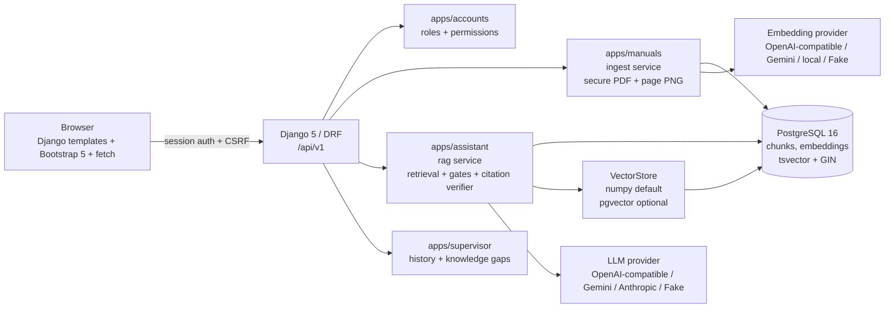

# ManualMind

A Django web app that answers maintenance questions from manufacturing equipment
manuals, with every answer tied to a quoted passage, a document revision and a
rendered image of the cited PDF page.

The product name lives in exactly one place, `settings.APP_NAME`.

> **Safety.** The dataset is fictional training material. The assistant summarises
> manuals; it never authorizes operation, repair or return to service. That notice
> is shown on every page and is written into the system prompt.

## What each role does

| Role | Can do |
| --- | --- |
| **Administrator** | Register machines, upload PDF manuals with document ID, title, model and revision, watch indexing status, reindex |
| **Engineer** | Select a machine, ask a question, read a grounded answer with citations, revisit their own history |
| **Supervisor** | Read-only view of every question, filterable, plus a Knowledge Gaps view of what the manuals do not cover |

Roles are Django Groups and are enforced by DRF permission classes in
`apps/accounts/permissions.py`. The UI only hides links; the server decides.

## Quick start with Docker

```bash
cp .env.example .env          # then edit the provider settings
docker compose up --build -d
docker compose exec web python manage.py migrate
docker compose exec web python manage.py seed_demo
# open http://localhost:8000/
```

## Quick start without Docker

Needs Python 3.11+ and a PostgreSQL 16 server.

```bash
python -m venv .venv && . .venv/bin/activate   # Windows: .venv\Scripts\activate
pip install -r requirements.txt
cp .env.example .env                           # set POSTGRES_HOST=127.0.0.1
createdb manualmind
python manage.py migrate
python manage.py seed_demo
python manage.py runserver
```

## Commands

| Command | Purpose |
| --- | --- |
| `python manage.py migrate` | Create the schema |
| `python manage.py seed_demo` | Groups, demo users, machines and the three student-pack manuals. Idempotent |
| `python manage.py seed_demo --no-manuals` | Users and machines only, so the upload can be demonstrated live |
| `python manage.py runserver` | Start the app |
| `python -m pytest` | Run the test suite (no API key needed) |
| `python manage.py eval_rag` | Score the golden question set, write `eval/report.md` |
| `python manage.py reindex_all` | Re-embed everything. Required after changing `EMBEDDING_MODEL` |
| `python manage.py enable_pgvector` | Optional, only for `VECTOR_BACKEND=pgvector` |

## Demo credentials

Created by `seed_demo`; passwords come from `.env`, default `Demo@1234`.

| Username | Role |
| --- | --- |
| `admin1` | Administrator |
| `engineer1` | Engineer |
| `supervisor1` | Supervisor |

## Configuring a model provider

Everything is set through `.env`; no code changes. See `.env.example` for a
worked example of each line.

| `EMBEDDING_PROVIDER` | Notes |
| --- | --- |
| `fake` | Deterministic hashed bag-of-words. Default, needs no key, used by the tests |
| `openai_compatible` | OpenAI, Azure-style gateways, Ollama `/v1`, LM Studio |
| `gemini` | Google Generative Language API |
| `sentence_transformers` | Local model, e.g. `BAAI/bge-small-en-v1.5`. Install the optional package |

`LLM_PROVIDER` accepts `fake`, `openai_compatible`, `gemini` or `anthropic`.

`EMBEDDING_DIM` must match the embedding model. The app refuses to start on a
mismatch it can detect, and changing the model requires `manage.py reindex_all`
because the stored vectors are model-specific.

## Vector backend

`VECTOR_BACKEND=numpy` is the default and needs no database extension.

- **numpy** — the machine filter runs in SQL first, only that machine's
  embeddings are loaded, and cosine similarity is one matrix-vector product
  because vectors are L2-normalised at ingestion.
- **pgvector** — optional. `ORDER BY embedding::vector <=> %s::vector` with the
  same machine filter in the `WHERE` clause. Enable the extension with
  `manage.py enable_pgvector`; it is deliberately not a migration, so a missing
  extension can never break a migration run.

`GET /health/` reports which backend is active, along with the configured
providers and the database check.

## Architecture



Business logic lives in `services/`, not in views:
`apps/manuals/services/extract.py`, `apps/manuals/services/ingest.py`,
`apps/assistant/services/rag.py`, `.../vectorstore.py`, `.../citations.py`.

## How isolation and citation verification work

- **The machine filter is part of the query, not a post-filter.** Every retrieval
  path starts from `rag.machine_chunks(machine)`, which filters
  `chunk.machine_id` together with `manual.is_active` and `manual.status` inside
  the SQL `WHERE`. Vector search, full-text search and exact-identifier search all
  use it, so a chunk from another machine is never scored, never fused and never
  reaches the model. `Chunk.machine_id` is denormalised and indexed for this.
- **Hybrid retrieval, then RRF.** Vector top-12, Postgres
  `websearch_to_tsquery` top-12, and exact `ILIKE` matches for alarm codes
  (`E\d{2}`) and part identifiers (`[A-Z]{2}-\d{2}`), fused with Reciprocal Rank
  Fusion (k=60) down to 6 passages. Pure vector search misses exact codes like
  `E42`, `RF-20` and `AF-10`; the exact pass is what guarantees they are found.
- **Two independent evidence gates.** Gate 1 refuses before any model call when
  retrieval returns nothing, or when the best vector similarity is below
  `RETRIEVAL_MIN_SCORE` and no exact identifier matched. Gate 2 is the model's own
  structured verdict. If either refuses, no partial content is shown.
- **Chunk ids are checked against what was retrieved.** A citation whose
  `chunk_id` was not in the supplied context is dropped: the system cannot display
  a source it did not retrieve.
- **The displayed quote always comes from the stored chunk.** The model's quote is
  located in the chunk by exact match on normalised text, then by a sliding
  `difflib` window at ratio 0.9. If it is found, the matched span of the *stored*
  text is shown and `quote_verified=true`. If the model paraphrased, the citation
  is kept but the quote is replaced by the stored chunk text and
  `quote_verified=false`. An answer is downgraded to insufficient evidence only
  when no citation has a valid chunk id, never because string matching failed.

Each source card also renders the cited PDF page as a PNG
(`/api/v1/manuals/{id}/page/{n}/preview/`), so the physical page sits beside the
quote.

## Measured quality

`python manage.py eval_rag` runs 17 golden questions through the real configured
providers and writes `eval/report.md`. It reports status accuracy, citation
precision, key-phrase hit rate, average latency, and **isolation violations,
which must be 0**.

With the default `fake` providers on the seeded student pack:

| Metric | Value |
| --- | --- |
| Retrieval recall (expected document+page inside the 6-passage context) | **12 / 12** |
| Isolation violations | **0** |
| Status accuracy | 70.6% |
| Citation precision | 83.3% |

Retrieval recall and isolation are properties of this codebase and are perfect.
The status and key-phrase numbers are capped by `FakeLLM`, which is a stub that
always answers and only ever cites the first passage, so it cannot refuse an
out-of-scope question or cite two documents. Re-run `eval_rag` once a real model
is configured to measure those two rows.

### What calibration showed

Gate 1 is not the out-of-scope filter, and the measurements say why. With the
fake embeddings, answerable questions score 0.120–0.633 while out-of-scope ones
score 0.374–0.429: the ranges overlap, because "What is the pump replacement
price?" shares vocabulary with the page that says prices are not provided. A
score threshold therefore cannot separate them, and `RETRIEVAL_MIN_SCORE` is set
to `0.10`, just below the lowest answerable score, so gate 1 only skips a
genuinely hopeless retrieval. The honest refusal is gate 2's job, which works
because the manuals state outright which details they do not supply. The score
scale is model-specific, so re-run `eval_rag` after changing `EMBEDDING_MODEL`.

## API

All endpoints are under `/api/v1/`, use session auth plus CSRF, and return
`{"detail": str, "errors": {...}}` on failure.

| Method | Path | Who |
| --- | --- | --- |
| POST | `/auth/login`, `/auth/logout` | anyone / signed in |
| GET | `/auth/me` | signed in |
| GET | `/machines/` | signed in |
| POST | `/machines/` | Administrator |
| GET | `/manuals/?machine=<machine_id>` | signed in |
| POST | `/manuals/` (multipart) | Administrator. Others get 403 and an `AuditLog` `DENIED_UPLOAD` row |
| POST | `/manuals/{id}/reindex/` | Administrator |
| GET | `/manuals/{id}/pdf/` | signed in. Streamed by Django, never a public media URL |
| GET | `/manuals/{id}/page/{n}/preview/` | signed in. PNG at 150 dpi, 404 outside 1..page_count |
| POST | `/assistant/ask/` `{machine_id, question}` | Engineer, and Administrator for testing |
| GET | `/assistant/history/` | Engineer sees only their own; Supervisor and Administrator see all. Filters: `machine`, `status`, `date_from`, `date_to`, `search` |
| GET | `/assistant/history/{id}/` | same ownership rule |
| GET | `/supervisor/knowledge-gaps/` | Supervisor or Administrator |
| GET | `/supervisor/stats/` | Supervisor or Administrator |
| GET | `/health/` | anyone |

## Ingestion

PyMuPDF extracts each page separately; `page_number` is 1-based and matches the
printed page label. Chunks never cross a page or a section, target 500–900
characters with about 100 characters of overlap, and the text embedded for a
chunk is prefixed with `[model | document rev N | page N | section]` so the
vector carries that context. The original text is stored separately, which is
what makes quote verification possible.

Three details worth knowing, because the manuals in this pack need them:

- The repeated page header (`HP-OPS-01 | Rev 1.0 | Page 2`) is detected as the
  line that recurs on most pages and stripped from the chunk text, while the page
  number stays in metadata.
- Table rows are kept on one line as `Cell | Cell | Cell`. These tables have cells
  that wrap independently and are vertically centred, so one logical row arrives
  from PyMuPDF as several interleaved lines. Rows are rebuilt by anchoring on the
  first column and attaching the other cells by vertical proximity, and cells are
  grouped by clustering x positions. Tested against every table in the pack.
- Section headings are detected from boldness or a larger font on a short line
  with no trailing period, excluding anything that parsed as a table row.

Uploads are validated on the `%PDF` magic bytes rather than the extension, capped
at 20 MB, renamed to a UUID under `MEDIA_ROOT/manuals/`, and hashed. Re-uploading
a byte-identical file for the same machine and revision is a no-op. A new revision
of a `document_id` deactivates the previous row rather than overwriting it, and
inactive manuals are excluded from retrieval.

Ingestion runs through `run_ingestion(manual_id)`, which is synchronous today and
is the seam Celery takes over in Phase 2.

## Scalability

- **Retrieval sits behind a `VectorStore` interface.** Machine-prefiltered numpy
  cosine search today, which is instant at manual-corpus size and needs no extra
  infrastructure; a pgvector + HNSW backend is one `.env` switch away. Because the
  machine filter runs first, the scored set stays proportional to one machine, not
  to the corpus.
- **Ingestion is idempotent and revision-aware** (SHA-256 plus
  `document_id` + `revision`), so re-running it is safe, and it already sits
  behind a task interface that becomes a Celery task in Phase 2.
- **LLM and embedding providers are swapped through `.env`**, with a startup check
  that `EMBEDDING_DIM` matches the model.
- **The API is versioned (`/api/v1`) and stateless**, and every machine carries a
  `plant` field, so the system is ready for multiple sites.

## Phase 2 reuse plan

Phase 2 (visual inspection) is added as `apps/inspection/` and reuses:
roles and permission classes from `apps/accounts`, the base layout, navbar and
safety banner from `apps/core` and `templates/base.html`, the `/api/v1` error and
pagination conventions, the `run_ingestion` task seam for Celery, the
`QueryLog`/`AuditLog` pattern for traceability, and the Docker Compose file, whose
`redis` service is already present and commented out for Celery.

## Known limitations

- Ingestion is synchronous, so a very large PDF blocks the upload request.
- Only text-layer PDFs are supported; scanned pages would need OCR, which is out
  of scope for this round.
- The page-preview PNG is rendered per request. The disk cache keyed by
  SHA-256 + page is marked as a `TODO-OPT` seam.
- `document_id` is unique per revision rather than globally, because superseding a
  revision requires both rows to exist.
- No reranker, no streaming, no answer cache. These are deliberate `TODO-OPT`
  seams rather than missing work; see the optimization backlog in the build brief.
- `chunk_count` is computed per row when listing manuals, which is fine at this
  scale but would want annotation on a large corpus.
